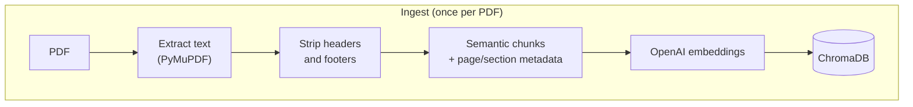
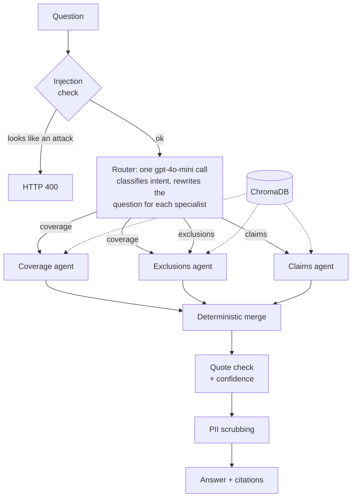

# InsureAgent

[](https://github.com/aravindkakumanu/insure-agent/actions/workflows/ci.yml)

Ask questions about an insurance policy in plain English and get answers that
cite the page and section they came from, flag how well grounded they are, and
say what is **not** covered as well as what is.

Built with FastAPI, LangGraph/LangChain, ChromaDB and OpenAI (GPT-4o for
answers, GPT-4o-mini for routing, `text-embedding-3-small` for embeddings). The
sample document is a 26-page homeowners policy jacket (Allstate form APC220, a
specimen published by state insurance regulators). It is **not included in this
repo**: policy PDFs are gitignored, so download it yourself (see Quickstart).

## How it works





A few choices worth knowing about:

- **Coverage questions always fan out to the Exclusions agent too.** An answer
  about what is covered that hides what is not is the failure this guards against.
- **Each specialist is its own LangGraph ReAct agent** with its own prompt and
  tool subset, a step limit that stops runaway loops, and its own memory.
- **Confidence is computed, not self-reported.** It is derived from what the
  retrieval tools returned, and it measures grounding, not correctness.
- **Quotes are checked.** Any passage the answer puts in quotation marks is
  looked up in the retrieved text; a miss lowers confidence and adds a note.
- **The merge is deterministic**, not another LLM call, so it cannot invent text.

The reasoning behind each decision, including what broke in live testing and
how it was fixed, is written up in [CLAUDE.md](CLAUDE.md) (lessons 7-30).

## Quickstart

Requires Python 3.10 and an OpenAI API key.

```bash
python3 -m venv .venv
source .venv/bin/activate
pip install -r requirements.txt
cp .env.example .env          # then set OPENAI_API_KEY
uvicorn main:app --reload
```

Get the sample policy. It is Allstate's document, so it is not committed here;
the Maine Bureau of Insurance hosts a specimen copy. Save it as
`data/policies/apc220-ho-policy-jacket.pdf`:

```bash
mkdir -p data/policies
curl -L -o data/policies/apc220-ho-policy-jacket.pdf \
  https://www.maine.gov/pfr/insurance/sites/maine.gov.pfr.insurance/files/inline-files/apc220-ho-policy-jacket.pdf
```

The server can refuse `curl` (it answered 403 in testing); if so, download the file
in a browser and move it there. The golden questions and the heading rules were
tuned on this exact document, so a different copy or version of the form may behave
differently.

Then ingest it once. This makes live embedding calls and is safe to repeat: it
replaces that PDF's chunks instead of duplicating them.

```bash
curl -X POST http://127.0.0.1:8000/ingest \
  -H "Content-Type: application/json" \
  -d '{"pdf_path": "data/policies/apc220-ho-policy-jacket.pdf"}'
```

Ask a question:

```bash
curl -X POST http://127.0.0.1:8000/ask \
  -H "Content-Type: application/json" \
  -d '{"question": "Does my policy cover a burst pipe?"}'
```

The response has this shape (values elided):

```json
{
  "answer": "What IS covered ... What is NOT covered ...",
  "session_id": "…",
  "agent": "coverage+exclusions",
  "confidence": "high",
  "citations": [
    {"source": "apc220-ho-policy-jacket.pdf", "page": 0, "page_end": 0,
     "section": "…", "subsection": "…"}
  ]
}
```

Pass the returned `session_id` back to ask a follow-up ("what about mold?").
Interactive docs are at `http://127.0.0.1:8000/docs`.

| Endpoint       | Purpose                                              |
|----------------|------------------------------------------------------|
| `GET /health`  | Liveness check                                       |
| `POST /ingest` | Load a PDF from `data/policies/` into the vector store |
| `POST /ask`    | Ask a question; optional `session_id` for follow-ups |

A request that looks like a prompt-injection attempt is rejected with HTTP 400.

## Tests

The default suite is fully offline (fake LLMs, no OpenAI or ChromaDB calls; a
fixture makes the real vector store raise if a test forgets to patch it):

```bash
pytest
```

This is what CI runs on every push and pull request.

A golden-question evaluation checks retrieval and answers against the real
policy. It needs the key and the ingested sample policy, so it is opt-in and runs locally
(CI runs only the offline suite, because the PDF is not in the repo):

```bash
RUN_LIVE_EVAL=1    pytest tests/integration/test_live_retrieval.py -v -s   # embeddings only
RUN_LIVE_EVAL=full pytest tests/integration/test_live_answers.py  -v -s    # router + GPT-4o
python -m tests.integration.probe <case-id>   # why did a case miss?
```

Run it after any change to retrieval, chunking or prompts; the run prints the
current result, so trust that over any number written down here. Cases that
miss on purpose are marked `known_gap` in `tests/integration/golden.py`, each
with the reason, and report as XFAIL. Two lay-wording questions ("how long do I
have to sue?", "do I need to report a theft?") currently do; both still pass end
to end. The history of what was measured and decided is in
[CLAUDE.md](CLAUDE.md), lesson 30.

## Tracing (optional)

Off by default. To trace every question end to end in
[LangSmith](https://smith.langchain.com), set `LANGSMITH_TRACING=true` and
`LANGSMITH_API_KEY` in `.env` (see `.env.example`) and restart the server. Each
`/ask` becomes one trace: the router's decision, which agents ran, every tool call
with its query and how many chunks it returned, token counts, and latency per step.
Traces contain the question and the retrieved policy text, so leave it off where
that is not acceptable. Details: [CLAUDE.md](CLAUDE.md), lesson 31.

## Project layout

```
main.py                     FastAPI app: /health, /ingest, /ask
src/rag/                    loader (PDF, chunking), structure (page/section metadata), embedder
src/agents/router.py        intent classifier, fan-out, merge
src/agents/*_agent.py       Coverage, Exclusions and Claims specialists
src/agents/tools.py         retrieval tools that return evidence records
src/agents/results.py       typed results, quote check, confidence
src/agents/guardrails.py    injection check, PII scrubbing, low-confidence warning
tests/                      offline tests; tests/integration/ holds the live eval
```

## Known limits

- Built and tuned on one policy. The section-heading rules are specific to its
  layout, so another policy layout needs its own rules.
- Conversation memory and the router's session state live in process memory and
  are lost on restart.
- No authentication, rate limiting or multi-tenancy.
- Confidence says how well grounded an answer is, not whether it is complete or
  right, and the injection check is a tripwire, not a defence.
- Not legal or insurance advice. Answers come from the policy text and can be wrong.
